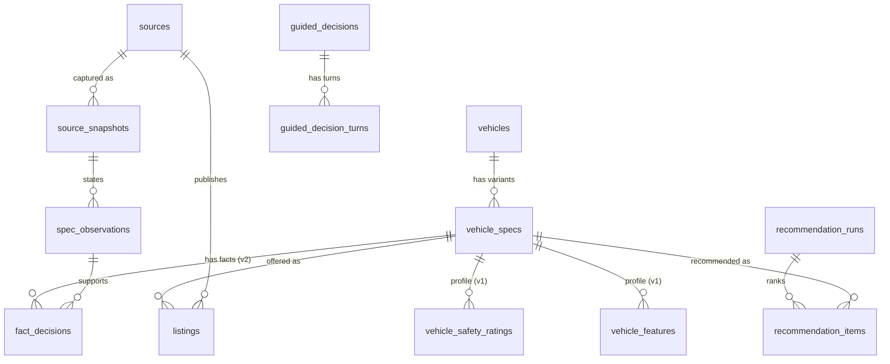

# Drivewise data model

This page describes the PostgreSQL schema after migration `0016`: 21 tables and
7 views. It states what each table stores and which rules the database enforces.
The reasons for the catalogue rules are in [Catalog v2](catalog-v2.md). The
proposed change to vehicle identity is in
[the identity and facts design](catalog-identity-and-facts-design.md).

To list the tables and views of a migrated database, run:

	psql "$DATABASE_URL" -At -c "select relname, relkind from pg_class c join pg_namespace n on n.oid = c.relnamespace where n.nspname = 'public' and relkind in ('r','v') order by 2, 1"

## The groups of tables

| Group | Tables | Written by |
| --- | --- | --- |
| Catalogue identity | `vehicles`, `vehicle_specs` | v1 import, v2 publisher |
| Evidence (v2) | `sources`, `source_snapshots`, `spec_observations`, `fact_decisions`, `catalog_v2_batches` | v2 publisher |
| Record provenance and profile (v1) | `vehicle_provenance`, `vehicle_spec_provenance`, `vehicle_safety_ratings`, `vehicle_features`, `vehicle_maintenance_items`, `vehicle_media_assets`, `import_runs` | v1 import |
| Offers | `listings` | v1 import |
| Sessions and results | `guided_decisions`, `guided_decision_turns`, `recommendation_runs`, `recommendation_items` | API |
| Text search | `documents` | local ingestion |

`drivewise_schema_migrations` records the applied migrations and their checksums.

## Two catalogue versions share the identity tables

`vehicles.catalog_version` and `vehicle_specs.catalog_version` are `1` or `2`.

- **Version 1** rows hold their values in columns. The v1 import writes them from
  a reviewed JSON file. Outside the `local` and `test` environments the v1 import
  refuses to write.
- **Version 2** rows hold identity in columns and every measured value in
  `fact_decisions`. The read views compute the columns that the API and the
  Advisor read.

The triggers `vehicles_v2_writer` and `vehicle_specs_v2_writer` reject an update
of a version 2 row unless the v2 publisher made it.

No database holds reviewed real cars. Production serves the synthetic demo bundle.

## Catalogue identity

### `vehicles`

One row is one catalogue vehicle in one market.

| Column | Meaning |
| --- | --- |
| `canonical_key` | Stable import identity. Unique. |
| `model_family_key` | Groups the vehicles of one model in the product. |
| `make`, `model`, `market` | Required. `market` is a national code such as `IT`. |
| `vehicle_type` | `car`, `motorcycle`, or `scooter`. |
| `generation_key`, `phase_key`, `body_style`, `model_year` | Optional. The open-data import leaves all four empty. |
| `identity_evidence` | Snapshot ids that support the identity (v2). |
| `fuel_type`, `base_price_eur` | Version 1 mirrors of the default variant. |
| `legacy_record` | The v1 row as it was before a v2 adoption. |

The unique index `vehicles_identity_v2_key` covers `lower(make)`, `lower(model)`,
`vehicle_type`, `generation_key`, `phase_key`, `body_style`, `model_year`, and
`market`. It treats two empty values as equal.

A published version 2 identity is frozen. The publisher accepts one change: it
fills an empty `body_style` when a new snapshot states it. It rejects every other
difference, including a generation that was empty.

### `vehicle_specs`

One row is one variant of a vehicle. `variant_key` is unique. At most one variant
per vehicle has `is_default`.

| Columns | Version 1 | Version 2 |
| --- | --- | --- |
| `trim`, `transmission`, `drivetrain`, `engine_code`, `powertrain_type`, `fuel`, `valid_from`, `valid_to`, `external_references`, `identity_evidence` | partly used | identity of the variant |
| `fuel_type` | stored | derived by the publisher from `powertrain_type` and `fuel` |
| `body_style` | stored | copied from the vehicle |
| `horsepower`, `battery_kwh`, `consumption_l_100km`, `energy_consumption_kwh_100km`, `wltp_range_km`, `co2_g_km`, `seats`, `cargo_volume_liters`, `list_price_eur`, `euro_emission_standard` | stored | empty; the read views fill the ones that have a fact |
| Knowledge profile: `generation_name`, `restyling_label`, `category`, `doors`, `length_mm`, `width_mm`, `height_mm`, `wheelbase_mm`, `curb_weight_kg`, `gross_weight_kg`, `payload_kg`, `displacement_cc`, `cylinders`, `power_kw`, `torque_nm`, `battery_usable_kwh`, `transmission_type`, `gear_count`, `differential_type`, `acceleration_0_100_s`, `top_speed_kmh`, `braking_100_0_m`, `homologation_cycle` | stored | empty; the read views fill dimensions and power from facts |

`powertrain_type` is `ICE`, `MHEV`, `HEV`, `PHEV`, or `BEV`.

## Evidence (version 2)

Every published value follows one chain: a source, a snapshot of a document, an
observation in that document, and a decision about the fact.

### `sources`

One row is one origin of data. `source_key` and `name` are unique.

`ranking_permission` is `permitted`, `not_permitted`, or `manual_validation_only`.
Only a `permitted` source with a non-empty `license` can make a value eligible for
ranking. A change of permission takes effect on the next read.

`source_type` is `manual_seed`, `public_dataset`, or `curated_internal`.

### `source_snapshots`

One row is one captured document: `source_id`, HTTPS `source_url`, `retrieved_at`,
`content_sha256`, `artifact_path`, and `media_type`. `evidence_kind` is `sourced`,
`synthetic`, or `legacy`. Only `sourced` evidence can rank.

### `spec_observations`

One row is one value that a snapshot states for one metric.

| Column | Meaning |
| --- | --- |
| `spec_id` | The variant, or empty while `candidate_variant_keys` lists the possible ones. |
| `metric` | A name from the `catalog_metric` domain. |
| `raw_value`, `raw_unit` | The text as the document prints it. |
| `value_min`, `value_max`, `unit` | The normalized interval. Both numbers are required. |
| `context` | The market, plus the terms that define the measure: procedure and cycle, method, seating configuration, validity dates. |
| `evidence_excerpt`, `evidence_locator` | The quoted text and where it is in the document. |
| `list_price` | The terms of a list price (ADR-015). Present only for `list_price_eur`. |

The `catalog_metric` domain has 24 names. A value is always numeric.

### `fact_decisions`

One row is one decision about one fact of one variant: `spec_id`, `metric`, and
`context`.

- `status` is `verified`, `unknown`, `not_applicable`, or `conflicted`.
- A `verified` decision names its `selected_observation_id`. A `conflicted`
  decision names at least two observations in `evidence_ids`.
- `actor_kind` is `human`, `rule`, or `agent`. A decision by an `agent` never
  makes a fact eligible for ranking.
- `supersedes_id` links a decision to the one that it replaces. A fact has one
  root decision and each decision has at most one successor.

Every fact belongs to a variant. No fact can belong to a vehicle.

### `catalog_v2_batches`

One row is one staged bundle: its `payload`, its `dataset_hash`, and
`published_at` once it is published. A staged bundle changes nothing until
publication.

### Rules that the database enforces

- `source_snapshots`, `spec_observations`, and `fact_decisions` reject every
  `UPDATE`, `DELETE`, and `TRUNCATE`.
- Snapshot URLs are HTTPS.
- A decision cannot predate the decision that it supersedes.
- The `valid_from` and `valid_to` of a decision context are ISO dates.

## Read views

The API and the Advisor read the catalogue through these views, never through the
evidence tables.

| View | Returns |
| --- | --- |
| `catalog_identity_eligibility` | Per variant, whether every identity snapshot of the variant and of its vehicle is sourced, permitted, and licensed. |
| `catalog_current_facts` | The current decision of every fact, with its observation and source, and an `eligible` flag. |
| `catalog_scalar_facts` | The eligible facts that have one value for the whole variant. An interval consumption is published at its upper value (ADR-018). |
| `catalog_read_specs` | One row per variant with the column shape of `vehicle_specs`. Version 1 columns pass through. Version 2 columns come from `catalog_scalar_facts`. |
| `catalog_read_provenance` | Per variant and metric, the source that supports the value, for both versions. |
| `catalog_analysis_specs` | `catalog_read_specs` with each value hidden unless a permitted source supports it. |
| `catalog_usable_listings` | The active Italian offers from permitted, licensed sources with a completed import. |

A fact is `eligible` when its decision is `verified`, a human or a rule made it,
the identity of the variant is eligible, and every observation behind it comes
from a sourced snapshot of a permitted, licensed source.

## Record provenance and knowledge profile (version 1 only)

`vehicle_provenance` and `vehicle_spec_provenance` link a version 1 record to the
source that supports named metrics. `import_runs` records each v1 import by
dataset hash, so that an identical import changes nothing.

Four tables hold profile details of a variant. Each row stores its own source,
`source_url`, and `observed_at`. None of them uses the evidence chain, and the
repositories read them for version 1 variants only.

| Table | One row is | Unique on |
| --- | --- | --- |
| `vehicle_safety_ratings` | A safety assessment: `assessment_system`, `assessment_year`, `overall_stars`, and four percentage scores. | `spec_id`, `assessment_system`, `assessment_year` |
| `vehicle_features` | An equipment item: `feature_key`, `category` (`adas`, `safety`, `technology`, `comfort`), and `availability` (`standard`, `optional`). | `spec_id`, `feature_key` |
| `vehicle_maintenance_items` | A service operation with an interval in kilometres or months. | `spec_id`, `operation_code` |
| `vehicle_media_assets` | A photo, a brochure, or a manual, by HTTPS `url`. | `spec_id`, `asset_key` |

The Advisor safety module reads `vehicle_safety_ratings`. A version 2 variant has
no row there, so the module returns `insufficient_data` for it.

## Offers

### `listings`

One row is one offer of one variant from one source. `(source_id, listing_ref)` is
unique.

| Column | Meaning |
| --- | --- |
| `vehicle_id`, `spec_id` | The vehicle and the variant. A composite foreign key keeps the pair consistent. `spec_id` is empty only on unresolved legacy rows. |
| `price_eur`, `mileage`, `condition` | `condition` is `new`, `used`, or `certified`. `mileage` is in kilometres. |
| `source_url` | The HTTPS address of the offer. |
| `first_seen_at`, `last_seen_at`, `valid_until`, `is_active` | Freshness. The Advisor excludes a stale, expired, or inactive offer. |
| `content_hash`, `import_run_id`, `raw_payload` | Import bookkeeping. |

A variant with no usable offer is evaluated at its list price (ADR-013).

## Sessions and results

### `guided_decisions` and `guided_decision_turns`

`guided_decisions` stores the current Decision Profile of a session, its
`profile_version`, and the last response. `status` is `active`, `completed`, or
`abandoned`.

`guided_decision_turns` stores one row per profile version: both messages, the
changed fields, the full profile snapshot, and the full response.
`(decision_id, profile_version)` is unique.

A scheduled job deletes sessions that are older than 30 days.

### `recommendation_runs` and `recommendation_items`

`recommendation_runs` stores one row per Advisor run: the normalized request,
`scoring_version`, the assumptions, and the exclusion counts.

`recommendation_items` stores the ranked results of a run. Each item names its
vehicle and variant. `listing_id` is empty when the item was evaluated at its list
price. `score_breakdown` holds the full explanation. Rank and vehicle are unique
within a run and a `condition_group` (`new`, `used`, or `legacy`).

## Text search

`documents` stores text for search: `document_type`, `title`, `content`, an
optional `embedding`, and links to a source, a vehicle, or a listing. Only a fake
embedding provider exists. The routes that read it are internal. See
[ingestion](ingestion.md), [embeddings](embeddings.md), and [search](search.md).

## Migrations

Run the migrations with `python apps/api/scripts/migrate.py`. The script takes a
lock, so two runs cannot apply the same file.

| File | Adds |
| --- | --- |
| `0001` | The pgvector extension. |
| `0002` | The first schema: vehicles, specs, sources, listings, documents, recommendations. |
| `0003` | Five synthetic seed vehicles. |
| `0004` | Stable keys, variant-linked offers, import runs, and record provenance. |
| `0005` | The knowledge profile columns and the four profile tables. |
| `0006` | Guided Decision sessions and turns. |
| `0007` | HTTPS for every provenance URL. |
| `0008` | Evidence storage: snapshots, observations, decisions, and the metric domain. |
| `0009` | Catalogue versions, staged batches, the v2 identity index, and the read views. |
| `0010` | Two-wheel metrics. |
| `0011` | The list price metric and its terms (ADR-015). |
| `0012` | List price in the read views, and the upper value of an interval (ADR-018). |
| `0013` | Plug-in hybrid fuel names that the Advisor scores. |
| `0014` | Provenance for a body style filled after publication. |
| `0015` | A single pivot for version 2 values in the read views. |
| `0016` | No truncation of evidence, HTTPS snapshots, valid context dates, human or rule sign-off, and lookup indexes. |

## Limits of this model

- A generation cannot be filled after publication.
- A fact belongs to a variant, never to a vehicle.
- A fact value is always a number.
- Safety ratings and equipment exist for version 1 only, outside the evidence
  chain.
- The list of metrics is repeated in the SQL domain, the Python contract, and the
  JSON schema.

[The identity and facts design](catalog-identity-and-facts-design.md) proposes a
change for each limit.
